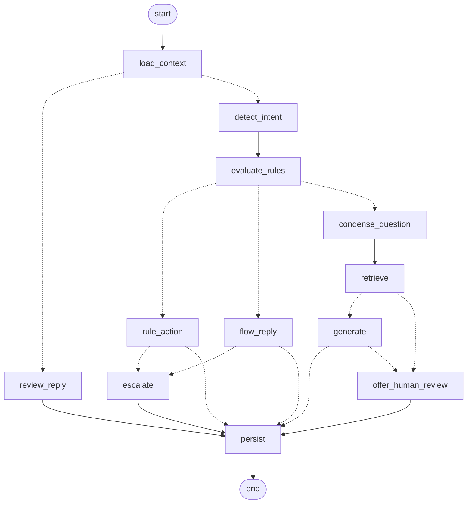

# LangChain RAG and the LangGraph Support Workflow

This is the current AI architecture. It replaced an earlier hand-written
pipeline; the table below shows what changed.

## What changed

| Area | Before (hand-written) | Now (LangChain / LangGraph) |
|---|---|---|
| Chat pipeline | One long `respond()` function | `StateGraph` with 12 typed nodes and conditional edges (`backend/app/services/ai/graph.py`) |
| Model calls | Direct `httpx` call to Gemini REST | `ChatGoogleGenerativeAI` in two LCEL chains (`chains.py`) |
| Follow-up memory | Keyword heuristic expands the search query | `condense_question` node: Gemini rewrites the follow-up into a standalone question using the last 6 messages |
| "Cannot answer" detection | Model replies with a `NO_ANSWER` text token | Structured output: Pydantic `GroundedAnswer {answer, answerable, used_sources}` |
| Embeddings | Local hash vectors (not semantic) | `gemini-embedding-001` reduced to 384 dimensions and normalized; hash vectors remain the offline/test fallback |
| Retrieval | Custom function | `TenantHybridRetriever(BaseRetriever)` over the existing `knowledge_chunks` table |
| Chunking | 120-word windows | `RecursiveCharacterTextSplitter` (800 characters, 120 overlap); PDFs are loaded per page, so citations carry the page number |

The HTTP API and the React frontend did not change.

## The workflow graph

Generated from the compiled graph with `support_graph.get_graph().draw_mermaid()`.
Dotted arrows are conditional edges.



| Node | Kind | What it does |
|---|---|---|
| `load_context` | code | Loads conversation memory and the last 6 messages |
| `review_reply` | code | Handles "yes"/"no" to a pending human-review offer; "yes" creates a ticket |
| `detect_intent` | code | Menu flow, `help`/`restart`/`talk to an agent`, order-ID entities |
| `evaluate_rules` | code | Company rules in priority order, audit log per rule |
| `rule_action` / `flow_reply` | code | Deterministic replies |
| `escalate` | code | Creates or reuses the conversation's open ticket |
| `condense_question` | **LLM** | Rewrites a follow-up into a standalone question (skipped without history) |
| `retrieve` | retriever | Tenant-scoped hybrid search, top 3 usable chunks |
| `generate` | **LLM** | Grounded answer with structured output and cited sources |
| `offer_human_review` | code | Offers a ticket when there is no evidence, no answer, or the provider fails |
| `persist` | code | Saves messages, LLM usage and conversation state in one commit |

The model is used in only two nodes. It never chooses an action, a tool, a
permission or the tenant. Those decisions are graph edges written in code.

## Retrieval scoring

```text
score = (1 - w) * lexical + w * semantic
semantic = rescaled cosine similarity (Gemini floor 0.5)
w = 0.5 for Gemini embeddings, 0 for the hash fallback
usable = shares a meaningful word OR semantic >= 0.3
```

- The organization filter is applied before ranking. Above 2,000 chunks per
  tenant, pgvector narrows candidates by cosine distance first.
- Chunks embedded by a different model are ranked by words only until they are
  re-indexed: `docker compose exec backend python -m app.scripts.reindex`.
- If the embedding API fails at query time, retrieval falls back to word
  matching. If the chat model fails, the user is offered a human.

## Why not LangChain's PGVector store or a prebuilt agent?

- `PGVector` creates its own tables outside our schema and tenant model. A
  custom `BaseRetriever` keeps tenant filtering and hybrid ranking in our code
  while still plugging into LangChain.
- A tool-calling agent would let the model decide escalation or ticket
  creation. Here those are deterministic edges, which are auditable and
  testable.

## Testing

`tests/test_langgraph.py` covers the graph structure, semantic retrieval
without shared words, tenant isolation in the retriever, rules running before
any model call, provider failure, and rewrite failure. Tests replace the two
model calls with `FakeChains` and use hash embeddings, so they run offline.

## Interview answers

**Why LangGraph instead of one function?** Each step is a small, testable node
with typed state, and branching is explicit in the edges. The graph can be
drawn from the code, and new steps (for example sentiment or a reranker) are
added as nodes without touching the others.

**How does memory work?** The backend loads the last 6 tenant-scoped messages.
`condense_question` turns "Is the battery covered too?" into "Is the battery of
the SonicWave Earbuds covered by the warranty?", and both retrieval and the
answer use that standalone question.

**What if Gemini is down?** Rewrite falls back to the original question,
embeddings fall back to word search, and generation failure offers a human
review ticket. No step returns an invented answer.
